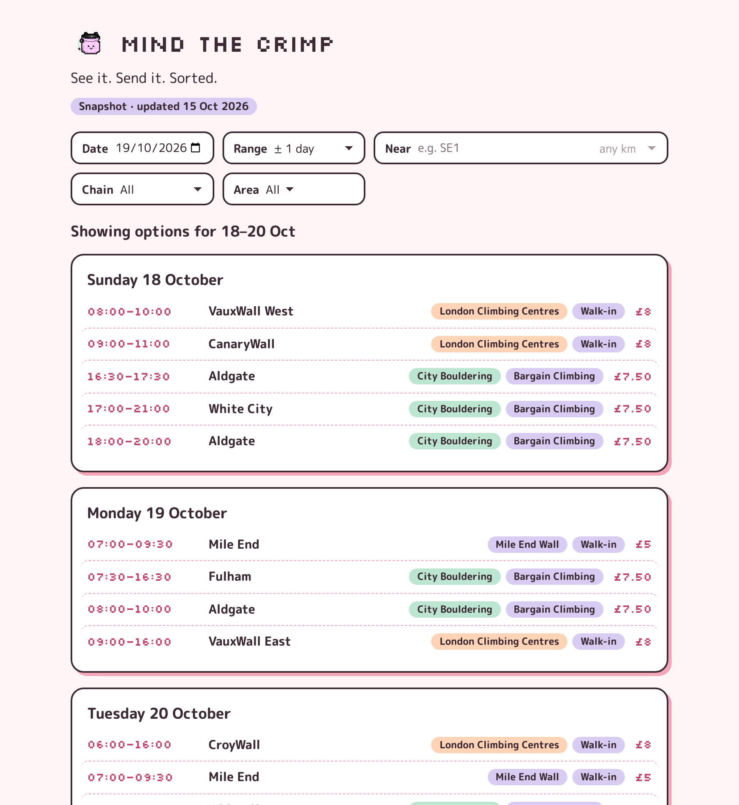

# Mind the Crimp!
Checks for sub-£10 climbing sessions for adults in London and shows data for the next 28 days

**Live:** https://annielkn.github.io/mind-the-crimp/

## Quick start
Setup:
`python3 -m venv venv && . venv/bin/activate && pip install -r requirements.txt && (cd web && npm install && npm run build)`

- CLI: `python3 main.py`
- Web: `python3 server.py` → http://localhost:8000
- Frontend dev: run `python3 server.py`, then `cd web && npm run dev` (proxies `/api` to :8000)

Note:
`web/dist` isn't committed. The build step in Setup (needs network) must run once before `server.py` can serve the page

## Data modes
- `OFFLINE=1` (default): no network. Shows the last live fetch if there is one, otherwise the bundled snapshot in `data/public/sessions.json`
- `OFFLINE=0`: fetches live from gym websites and saves the result locally. Please keep request volume low

## Architecture
- **Config** (`config/`): each chain names a `source` adapter; centres hold address, area, hours and lat/lng.
- **Adapters** (`adapters/`): one per source, all returning the same session shape; `manual` expands hand-entered weekly rules with no network.
- **Pipeline** (`main.py`): runs every adapter, merges centre info, sorts, and saves a snapshot only if every chain succeeded.
- **Server** (`server.py`): `GET /api/sessions` plus the built site; GitHub Pages serves the same page with the committed snapshot instead.
- **Frontend** (`web/`): React + Vite; all filtering (date, range, distance, chain, area) happens in the browser, with state in the URL.

## Design decisions
- **Offline by default.** Development and demos never touch gym websites; a committed snapshot means a fresh clone runs with zero network calls.
- **Polite scraping.** One network choke point (`adapters/common.py`) enforces `OFFLINE`, an honest User-Agent, and a per-host gap of `max(1s, robots.txt Crawl-delay)`. Every host's robots.txt was checked.
- **All-or-nothing refreshes.** A partial refresh never replaces the last good data, so one broken site can't blank the page.
- **London time everywhere.** "Today", snapshot dates and timestamps use Europe/London explicitly, not the machine's zone (CI runs in UTC).
- **Public/private split.** Optional adapters in a gitignored `adapters/private/` load only if present; `tools/check_public.sh` (pre-commit hook + CI) blocks anything private from being committed, and tests prove the app runs without them.
- **Static-friendly frontend.** Relative asset paths, self-hosted fonts and a static data fallback, so the same build works at `/`, under `/mind-the-crimp/`, and offline.
